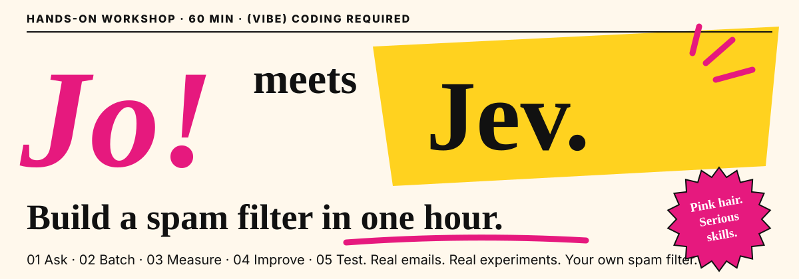

# Meet Jev: build a spam filter in one hour

It's 2002. Your inbox is full of Lagos barristers asking for "assistance", mortgages at 6.25% and "New Improved Weight Loss, Now With Bonus Fat Absorbers!". You have one hour, a laptop and Jev. Your job is to build a spam filter that bins the junk and leaves the real mail alone.

You'll ask Jev yes/no questions about real emails from the [SpamAssassin public corpus](https://spamassassin.apache.org/old/publiccorpus/). Then you measure the filter, improve it, try to sneak your own spam past it, and check whether it holds up on emails you've never seen. The same moves you learn today will work for any problem where software has to make a call a person could make at a glance.

## Meet the cast

- **Bart and Jo.** Your hosts. Pink hair, pink coat, and a catchphrase you'll hear a lot tonight: *Jev judges, code decides.*
- **Jev.** A model from [TypeSafe](https://typesafe.ai/). You give it data and yes/no questions, and it answers each with a number between 0 and 1. Think of it as a vibe check you can do maths with. It never makes the final call. Your code does.
- **The 2002 spammers.** Real spam, straight from the dial-up era. Barristers, cheap software, "Did I give you the money yet?".
- **The imposters.** Legit newsletters and shop mail that look like spam. Jeff Bezos writing to tell you about Amazon's new apparel store. They'll fool you, and they'll fool Jev.

## Who it's for

Data scientists, AI engineers, software engineers, architects and vibe coders. New to Python? Bring a coding agent. Every step has a prompt you can paste into it.

## You need

- [uv](https://docs.astral.sh/uv/getting-started/installation/). It installs Python 3.12 for you.
- A TypeSafe API key. We'll hand them out.
- A terminal open in this folder.

TypeSafe also has clients for JavaScript and other languages. If you port the workshop to one of them, you and your agent are on your own.

## Bringing a coding agent

Good idea. Use it to skip the typing, not the thinking. Every step ends with a **Brain on** section, one or two questions you should be able to answer before you move on. If you can't, ask your agent to explain it to you.

Jev is too new to be in any model's training data. Point your agent at the TypeSafe skill in [.agents/skills/typesafe-ai/SKILL.md](.agents/skills/typesafe-ai/SKILL.md) so it doesn't make up the API.

## Jev judges, code decides

Jev answers small questions a person could answer at a glance: is this a scam, does it sell something. Your code works out the facts it can know exactly, like whether a header is there, and combines both into the decision. Step 04 is built on this idea. [Don't call it a decision model](https://typesafe.ai/blog/dont-call-it-a-decision-model) explains how to use Jev and how not to.

## Agenda

| #   | Step                              | What happens                                            | Time   |
| --- | --------------------------------- | ------------------------------------------------------- | ------ |
| 00  | [Boot up](workshop/00-boot-up.md) | Install, say hello to Jev, play *Spam or not?*          | 10 min |
| 01  | [Ask](workshop/01-ask.md)         | One email, one question. Jev bins your Ryanair booking. | 10 min |
| 02  | [Batch](workshop/02-batch.md)     | Ten emails for the price of about six.                  | 5 min  |
| 03  | [Measure](workshop/03-measure.md) | The scoreboard of shame. Did Jev beat you at the quiz?  | 10 min |
| 04  | [Improve](workshop/04-improve.md) | Stop doing prompt yoga. Then spam your neighbour.       | 20 min |
| 05  | [Test](workshop/05-test.md)       | Exam day. Open the sealed envelope, once. Leaderboard.  | 5 min  |

Start with [step 00](workshop/00-boot-up.md). After the workshop, the [side quests](workshop/side-quests.md) are waiting: let your coding agent tune the filter for you, or point Jev at a problem of your own.

## Badges

Every checkpoint unlocks one. Collect all seven.

| Badge              | How                                                           |
| ------------------ | ------------------------------------------------------------- |
| 🏅 Hello, Jev       | Jev answers your first request (00)                           |
| 🏅 First contact    | Jev bins a legit email with a straight face (01)              |
| 🏅 Token miser      | You can explain when batching helps, and when it hinders (02) |
| 🏅 Scorekeeper      | You wrote down your baseline numbers (03)                     |
| 🏅 Precision sniper | Friendly fire drops to 0 or 1 on train (04)                   |
| 🏅 Spam lord        | Your spam lands in someone's inbox (04)                       |
| 🏅 Didn't peek      | You opened the test set exactly once (05)                     |

## Project map

| Path               | What it does                                                       |
| ------------------ | ------------------------------------------------------------------ |
| `extract.py`       | Unpacks the corpus archives into `dataset/`                        |
| `split.py`         | Writes the train and test sets to `splits/`. Already done for you. |
| `spam/corpus.py`   | Reads the corpus and labels every email by its partition           |
| `spam/message.py`  | Reduces a raw email to what Jev reads, and works out facts in code |
| `spam/jev.py`      | The questions Jev answers, asked for a batch of emails at once     |
| `spam/decision.py` | Combines Jev's judgments and the facts into a spam score           |
| `spam/solver.py`   | Sends every batch, a few at a time                                 |
| `spam/metrics.py`  | AUC, accuracy, precision and recall                                |
| `solve.py`         | Classifies a set and prints its scores                             |
| `tests/`           | Unit tests: `uv run pytest`                                        |

You or your agent will write a few small scripts of your own along the way: `peek.py` in step 00, `first_call.py` and `silly.py` in 01, `misses.py` and `quiz.py` in 03, and `judge.py` in 04.
