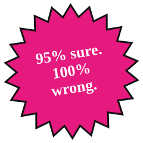

# 01 Ask (10 min)

[← 00 Boot up](00-boot-up.md) · [Agenda](../README.md) · [Next: 02 Batch →](02-batch.md)

**TL;DR.** Ask Jev one question about one email. Watch it call a legit Ryanair email spam. Then ask it some silly questions.

## Read

A Jev request has two parts:

- **`state`** is what Jev looks at. Here that's one email.
- **`questions`** is what you ask about it. A **Noul** is a yes/no question, and its answer is a number between 0.0 for no and 1.0 for yes. Jev knows other kinds of questions too. The side quests have pointers.

A question points at things in `state` by name, between backticks: `` `email` ``.

## Driving with an agent?

Paste this:

```
I'm doing step 01 of the workshop in workshop/01-ask.md. Create first_call.py exactly as written in its "Do"
section and run it. Then explain to me, in two sentences, what went into `state` and what went into
`questions`. Read .agents/skills/typesafe-ai/SKILL.md before you touch any TypeSafe code.
```

## Do

1. Create `first_call.py`:

   ```python
   import os
   from pathlib import Path

   from dotenv import load_dotenv
   from typesafe_sdk import Noul, TypeSafeClient

   from spam.jev import MODEL
   from spam.message import summary

   load_dotenv()

   email = summary(Path("dataset/20030228_hard_ham/00177.81236553338cae51575b54c6a07426f9").read_bytes())
   print(email)

   with TypeSafeClient(api_key=os.environ["API_KEY"], timeout=60) as client:
       result = client.system_one(
           state={"email": email},
           questions={"spam": Noul(instructions="Is `email` spam: unsolicited bulk or commercial email?")},
           model=MODEL,
       )
       print(result.answers["spam"].noul)
   ```

2. Run it:

   ```
   uv run first_call.py
   ```

## Checkpoint

The last line is a number close to **0.95**. Jev is pretty sure this is spam.

Plot twist. It's from `hard_ham`. Ryanair is selling travel insurance to a customer who signed up for their mail, and Jev just binned it. This is fine. 🔥

> 
> Jev answered 0.95. Jev is confident. Confident and right are two different things. Ask my hairdresser.

Remember this email. Step 04 rescues it.

🏅 **Badge unlocked: First contact.**

## Bonus: silly questions (2 min)

Jev isn't a spam model. It answers any yes/no question about anything you put in `state`. Create `silly.py` and point it at our friend the Lagos barrister:

```python
import os
from pathlib import Path

from dotenv import load_dotenv
from typesafe_sdk import Noul, TypeSafeClient

from spam.jev import MODEL
from spam.message import summary

load_dotenv()

email = summary(Path("dataset/20050311_spam_2/00895.d7895e10504f34149655062fe20d5174").read_bytes())

with TypeSafeClient(api_key=os.environ["API_KEY"], timeout=60) as client:
    result = client.system_one(
        state={"email": email},
        questions={
            "passive_aggressive": Noul(instructions="Is `email` passive-aggressive?"),
            "shouting": Noul(instructions="Is `email` written mostly in capital letters?"),
            "mum_would_fall_for_it": Noul(instructions="Would a trusting, non-technical parent believe `email`?"),
            "pirate": Noul(instructions="Does `email` sound like a pirate wrote it?"),
        },
        model=MODEL,
    )
    for name, answer in result.answers.items():
        print(f"{answer.noul:.2f}  {name}")
```

```
uv run silly.py
```

Now add a question of your own. Swap in another email from `splits/train.txt` if you like. Share the best one with your neighbour.

## Brain on

<details>
<summary>Why did Jev call a legit Ryanair email spam?</summary>

The question defines spam as "unsolicited bulk **or commercial** email". A travel insurance offer is commercial, so by the question's own definition it counts. Jev did what you asked. The question is the problem.

</details>

<details>
<summary>What goes in <code>state</code> and what goes in <code>questions</code>? How does a question know which email to look at?</summary>

`state` holds the data Jev looks at, here the email. `questions` holds what you ask about it. A question points at the email by naming its key in `state` between backticks: `` `email` ``.

</details>

### Deep cuts

<details>
<summary>Jev answered 0.95. Does that mean 95 out of 100 emails like this one are spam?</summary>

Not necessarily. 0.95 means Jev leans hard towards yes on this one question. Whether 95% of the emails it scores 0.95 really are spam is something you'd have to measure on labelled data. A confident answer can still be confidently wrong, just like with a chat LLM.

</details>

<details>
<summary>What would you do with emails scored 0.95, 0.55 and 0.05?</summary>

Draw a line and act on it. With the line at 0.5, the first two go to the spam folder and the last one to the inbox. The 0.55 sits close to the line, so a small change in wording or a rerun can flip it. You could send borderline scores to a "maybe spam" folder, or move the line up to protect real mail. Where to draw it depends on which mistake costs more. Step 03 gets into that.

</details>

[Next: 02 Batch →](02-batch.md)
