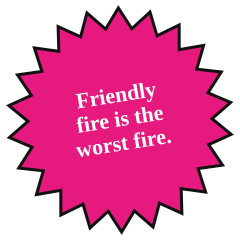
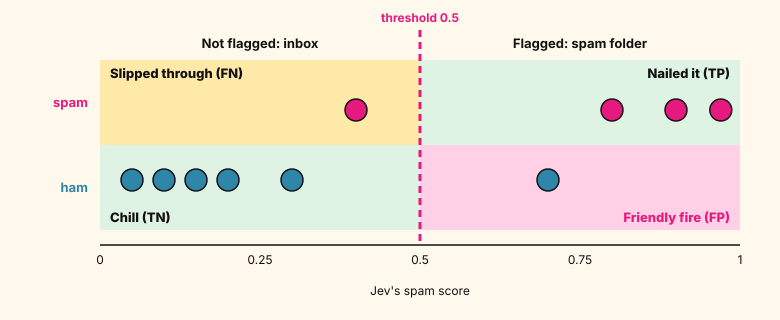
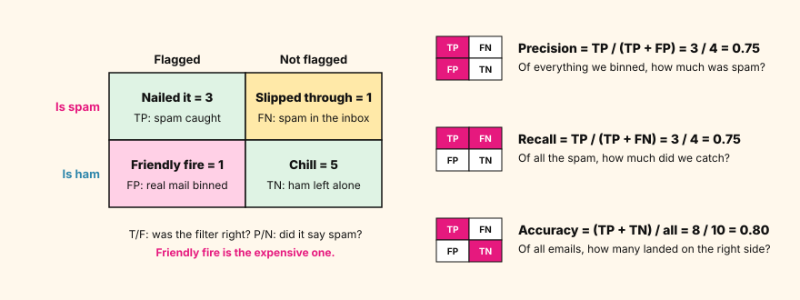
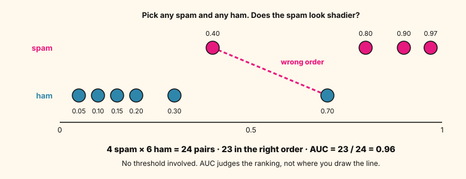

# 03 Measure (10 min)

[← 02 Batch](02-batch.md) · [Agenda](../README.md) · [Next: 04 Improve →](04-improve.md)

**TL;DR.** Run the filter on the 100 train emails, meet the four boxes every email lands in, read the misses, and find out whether Jev beat you at *Spam or not?*. Run `uv run solve.py train`.

Before you change anything, you need a score to beat. This step gets you one.

## Read

`solve.py` classifies a set of emails and prints:

| Number          | What it tells you                                                                                                               |
| --------------- | ------------------------------------------------------------------------------------------------------------------------------- |
| `auc`           | The chance that a random spam scores higher than a random ham. 1.0 means the ranking is perfect.                                |
| `accuracy`      | Share of emails on the right side of the 0.5 line.                                                                              |
| `precision`     | Share of the emails you binned that really are spam. Low precision means real mail in the spam folder.                          |
| `recall`        | Share of the spam you caught.                                                                                                   |
| `friendly fire` | Real emails that ended up in the spam folder. **This is the expensive mistake.**                                                |
| `slipped through` | Spam that made it to the inbox. Annoying, but you'll live.                                                                    |

### The four boxes

Ten made-up emails, four spam and six ham. Jev scores each one, and everything at 0.5 or above gets binned. Every email lands in one of four boxes:



- **Nailed it.** Spam, binned. Statisticians call it a true positive, TP.
- **Slipped through.** Spam that reached the inbox. False negative, FN.
- **Friendly fire.** Real mail in the spam folder. False positive, FP.
- **Chill.** Ham, left alone. True negative, TN.

Count the boxes and you get the confusion matrix. Precision, recall and accuracy each use different boxes:



AUC ignores the line. It only asks whether spam looks shadier than ham:



| AUC        | What it means                                                                                     |
| ---------- | ------------------------------------------------------------------------------------------------- |
| 1.0        | Every spam scores higher than every ham. Some line separates them perfectly.                      |
| 0.9 and up | Excellent. Only a few spam-ham pairs are in the wrong order.                                      |
| 0.5        | A coin flip. The scores say nothing about spam.                                                   |
| Below 0.5  | Worse than a coin flip. Something is upside down, like the question or the labels.                |

A high AUC tells you a good line *exists*. It doesn't tell you 0.5 is that line. That's how a filter can rank almost perfectly and still bin your real mail.

> 
> A missed spam costs you two seconds and a sigh. A binned job offer costs you the job. Watch the friendly fire.

## Driving with an agent?

Paste this:

```
I'm doing step 03 of the workshop in workshop/03-measure.md. Run solve.py on the train set, then create and
run misses.py and quiz.py exactly as written in the "Do" section. Show me the full output of all three.
Then tell me what the misses have in common. Never run anything on the test set.
```

## Do

1. Run the filter on the train set:

   ```
   uv run solve.py train
   ```

2. **Write down** `auc`, `accuracy`, `precision`, `recall`, `hard_ham` accuracy and `friendly fire`. On paper, in a notes file, on your hand. Step 04 overwrites this run, and you'll compare against these numbers in steps 04 and 05.

3. Create `misses.py`. It lists every email that landed in the wrong box:

   ```python
   import json
   import sys
   from pathlib import Path

   from spam.message import summary

   name = sys.argv[1] if len(sys.argv) > 1 else "train"
   for line in Path(f"out/{name}.jsonl").read_text().splitlines():
       row = json.loads(line)
       binned = row["spam"] >= 0.5
       if row["is_spam"] != binned:
           box = "friendly fire  " if binned else "slipped through"
           email = summary(Path(row["email"]).read_bytes())
           print(f"{box}  {row['spam']:.2f}  {email['from'][:40]:40}  {email['subject'][:60]}")
           print(f"      judgments {row['judgments']}  facts {row['facts']}")
   ```

   `solve.py` keeps a trace of every email in `out/train.jsonl`: Jev's **judgments**, the **facts** that code worked out (`facts` in `spam/message.py`), and the `spam` score that `spam/decision.py` made of them. Right now the decision just passes Jev's one judgment through and ignores the facts. Step 04 changes that.

4. Run it:

   ```
   uv run misses.py
   ```

5. Human vs. Jev. Create `quiz.py` and see how Jev did on the five quiz emails from step 00:

   ```python
   import json
   from pathlib import Path

   QUIZ = ["00572", "00895", "00237", "00408", "00276"]

   rows = [json.loads(line) for line in Path("out/train.jsonl").read_text().splitlines()]
   for quiz_id in QUIZ:
       row = next(r for r in rows if f"/{quiz_id}." in r["email"])
       truth = "spam" if row["is_spam"] else "ham"
       jev = "spam" if row["spam"] >= 0.5 else "ham"
       print(f"{quiz_id}  truth: {truth:4}  Jev: {jev:4} ({row['spam']:.2f})  {'right' if truth == jev else 'WRONG'}")
   ```

   ```
   uv run quiz.py
   ```

   Score yourself the same way. Who won, you or Jev?

## Checkpoint

Your numbers should be close to these. Jev's answers wobble a little from run to run.

|          | auc  | accuracy  | precision | recall | hard_ham accuracy | friendly fire |
| -------- | ---- | --------- | --------- | ------ | ----------------- | ------------- |
| Expected | 0.98–0.99 | 0.92–0.94 | 0.83–0.87 | 1.00   | 0.60–0.70         | 6–8           |

Every friendly fire is an imposter. They're newsletters and shop mail the recipient signed up for, from senders like CNET, Ryanair and dELiA*s. The question says "commercial email", so Jev bins them.

In the quiz, Jev gets the three spams right and usually falls for Jeff Bezos, just like it fell for Ryanair. It's close, about 0.53, so on your run he may just make it to the inbox.

🏅 **Badge unlocked: Scorekeeper.**

## Brain on

<details>
<summary>AUC is 0.98 but accuracy only 0.92. How can both be true?</summary>

Take five emails:

| Email                 | Is   | Score |
| --------------------- | ---- | ----- |
| Pills offer           | spam | 0.99  |
| Get-rich-quick        | spam | 0.95  |
| CNET newsletter       | ham  | 0.80  |
| Amazon order mail     | ham  | 0.70  |
| Mail from a colleague | ham  | 0.05  |

- **AUC** asks whether every spam scores higher than every ham. It does, so AUC is 1.0.
- **Accuracy** asks whether each email is on the right side of 0.5. The two newsletters aren't, so accuracy is 3 out of 5.
- With the line at 0.9, all five would be right.

Your baseline has the same problem. Almost every spam scores above the imposters, but 6 to 8 imposters still score above 0.5.

</details>

<details>
<summary>Why look at the misses before changing anything?</summary>

They tell you what to change. Here they share one pattern. They're newsletters and shop mail people signed up for. The trace shows a second problem. With one judgment, the decision has nothing to work with except that one number.

</details>

### Deep cuts

<details>
<summary>A set has 40 spam and 60 ham. The filter bins 50 emails: all 40 spam and 10 ham. Fill in the four boxes, then work out precision, recall and accuracy.</summary>

|             | Binned               | Not binned            |
| ----------- | -------------------- | --------------------- |
| **Is spam** | 40, nailed it        | 0, slipped through    |
| **Is ham**  | 10, friendly fire    | 50, chill             |

- **Precision** = nailed it / all binned = 40 / 50 = **0.80**
- **Recall** = nailed it / all spam = 40 / 40 = **1.00**
- **Accuracy** = (nailed it + chill) / all = (40 + 50) / 100 = **0.90**

Your baseline looks a lot like this, with 6 to 8 friendly fires instead of 10.

</details>

<details>
<summary>Why is friendly fire the expensive mistake for a spam filter?</summary>

A spam in the inbox is an annoyance. A real email in the spam folder may never get read.

</details>

[Next: 04 Improve →](04-improve.md)
