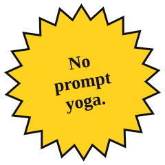

# 04 Improve (20 min)

[← 03 Measure](03-measure.md) · [Agenda](../README.md) · [Next: 05 Test →](05-test.md)

**TL;DR.** Split "is this spam?" into three small questions for Jev plus one fact from code, and let a tested rule make the call. Friendly fire drops to almost zero. Then try to sneak your own spam past the filter. Run `uv run pytest`, then `uv run solve.py train`.

## Read

### Stop doing prompt yoga

The obvious fix for step 03's misses is to keep the one question and bend it: "Is this spam… but not newsletters… that the recipient signed up for… unless it's on a Tuesday…". It works for a while. Then every new miss earns another clause, and the question twists itself around the exact emails you looked at. TypeSafe calls this **prompt gymnastics**. Jo calls it prompt yoga. Either way, stop.

> 
> Big questions are for philosophers. Jev wants small ones.

### Jev judges, code decides

[Don't call it a decision model](https://typesafe.ai/blog/dont-call-it-a-decision-model) is a 5-minute read on how Jev is meant to be used. The short version:

- Ask Jev only small questions that a person could answer at a glance. These are **judgments**.
- Let code answer whatever it can answer exactly. These are **facts**.
- Combine both into the decision **in code**, where you can read it and test it.

"Is this spam?" is a decision. It splits into three judgments and one fact:

| Input          | Who  | Question                                                                              |
| -------------- | ---- | ------------------------------------------------------------------------------------- |
| `scam`         | Jev  | Is the email a scam?                                                                  |
| `advertising`  | Jev  | Does it advertise a product or service?                                               |
| `legit_sender` | Jev  | Is it sent by a named, legitimate company or publication?                             |
| `list_mail`    | code | Does it have a `List-Unsubscribe` or `List-Id` header? See `facts` in `spam/message.py`. |

And one rule: **spam is a scam, or an ad from a stranger.** A sender isn't a stranger when it's a legitimate company, or when the mail comes through a mailing list.

The judgments are numbers between 0 and 1, so the rule uses fuzzy logic: `and` is `min`, `or` is `max`, and `not p` is `1 - p`. Feed it clean zeros and ones and it's plain old boolean logic. Feed it anything in between and you still get a score, so AUC keeps working.

## Driving with an agent?

Paste this:

```
I'm doing step 04 of the workshop in workshop/04-improve.md. Follow its "Do" section exactly, one numbered
step at a time: replace questions() in spam/jev.py, replace tests/test_decision.py, run the decision tests and
show me they fail, then replace spam() in spam/decision.py and run all tests. Use the code from the doc as
written: don't reword the questions. Then run solve.py on the train set, misses.py and quiz.py. Never run
anything on the test set. After each step, tell me in one sentence why it matters. Leave "Spam your
neighbour" to me.
```

## Do

1. In `spam/jev.py`, replace `questions` with:

   ```python
   def questions(email: str) -> dict[str, Noul]:
       """The judgments Jev makes about one email. `email` is that email's path in `state`."""
       return {
           "scam": Noul(
               instructions=f"Is `{email}` a scam?",
               criteria={
                   "true": "It pushes something dubious: miracle pills, get-rich-quick schemes, cheap software, "
                   "prizes, adult content, or asks for bank details.",
                   "false": "An honest message, even when it sells something.",
               },
           ),
           "advertising": Noul(instructions=f"Does `{email}` advertise a product or service?"),
           "legit_sender": Noul(instructions=f"Is `{email}` sent by a named, legitimate company or publication?"),
       }
   ```

2. Write the rule's tests first. Replace `tests/test_decision.py` with:

   ```python
   from spam.decision import spam


   def judged(scam=0.0, advertising=0.0, legit_sender=0.0):
       return {"scam": scam, "advertising": advertising, "legit_sender": legit_sender}


   def test_a_scam_is_spam_even_from_a_legitimate_sender_on_a_mailing_list():
       assert spam(judged(scam=1, legit_sender=1), {"list_mail": True}) == 1


   def test_an_ad_from_an_unknown_sender_is_spam():
       assert spam(judged(advertising=1), {"list_mail": False}) == 1


   def test_an_ad_from_a_legitimate_sender_is_not_spam():
       assert spam(judged(advertising=1, legit_sender=1), {"list_mail": False}) == 0


   def test_an_ad_through_a_mailing_list_is_not_spam():
       assert spam(judged(advertising=1), {"list_mail": True}) == 0


   def test_mail_that_neither_scams_nor_advertises_is_not_spam():
       assert spam(judged(), {"list_mail": False}) == 0


   def test_and_takes_the_lowest_or_takes_the_highest_and_not_flips():
       assert spam(judged(scam=0.2, advertising=0.9, legit_sender=0.3), {"list_mail": False}) == 0.7
   ```

3. Run them and watch them go red:

   ```
   uv run pytest tests/test_decision.py
   ```

4. Make them green. In `spam/decision.py`, replace `spam` with:

   ```python
   def spam(judgments: dict[str, float], facts: dict[str, bool]) -> float:
       """A scam, or an ad from a stranger. and = min, or = max, not = 1 - p."""
       known_sender = 1.0 if facts["list_mail"] else judgments["legit_sender"]
       return max(judgments["scam"], min(judgments["advertising"], 1 - known_sender))
   ```

5. Check that everything is green:

   ```
   uv run pytest
   ```

6. Run the train set again. Write the new numbers next to your step 03 numbers and compare:

   ```
   uv run solve.py train
   uv run misses.py
   uv run quiz.py
   ```

## Checkpoint

`32 passed`, and then:

|                     | auc  | accuracy  | precision | recall    | hard_ham accuracy | friendly fire |
| ------------------- | ---- | --------- | --------- | --------- | ----------------- | ------------- |
| Step 03 (expected)  | 0.98–0.99 | 0.92–0.94 | 0.83–0.87 | 1.00      | 0.60–0.70         | 6–8           |
| Step 04 (expected)  | 1.00      | 0.95–0.96 | 0.97–1.00 | 0.90–0.93 | 1.00              | 0–1           |

Every imposter stays in the inbox now, Ryanair and Jeff Bezos included. At most one real email gets binned, and it isn't even an imposter. It's a boingboing RSS item from `easy_ham` whose `legit_sender` sits just under 0.5, a coin flip. A few spams slip through. They're business ads from senders that look legitimate, and quiz email `00408`, the recruiting agency, is one of them. So in the quiz Jev now gets Bezos right and misses `00408`.

`misses.py` now shows **why** each email landed where it did. You can see which judgment or fact made the call instead of staring at one number. When an AI system gets something wrong, that's the difference between debugging and guessing.

🏅 **Badge unlocked: Precision sniper.**

## Spam your neighbour (5 min)

Time to switch sides. You're a 2002 spammer now, and your neighbour's filter is in your way.

1. Create `judge.py`. It runs your filter on one email file:

   ```python
   import asyncio
   import os
   import sys
   from pathlib import Path

   from dotenv import load_dotenv
   from typesafe_sdk import AsyncTypeSafeClient

   from spam import decision, jev
   from spam.message import facts, summary


   async def main(path: str) -> None:
       raw = Path(path).read_text(encoding="utf-8-sig").encode()
       async with AsyncTypeSafeClient(api_key=os.environ["API_KEY"], timeout=60) as client:
           [judgments] = await jev.ask(client, [summary(raw)])
       known = facts(raw)
       score = decision.spam(judgments, known)
       print(f"judgments {judgments}  facts {known}")
       print(f"spam score {score:.2f}: " + ("spam folder. Busted." if score >= 0.5 else "INBOX. You got through!"))


   load_dotenv()
   asyncio.run(main(sys.argv[1]))
   ```

2. Write a spam email in a file called `my_spam.eml`. Headers at the top, one per line, then an empty line, then the body. Create it in your editor. On Windows, PowerShell's `>` saves files as UTF-16, which `judge.py` can't read.

   ```
   From: Prince Totally Legit <prince@legit-riches.example>
   Subject: You have been selected!!!

   Dear friend, you have won a FREE cruise. Reply with your bank details to claim it today.
   ```

3. Send `my_spam.eml` to your neighbour, over chat or however you like. Your neighbour is the referee. They check that it really is spam, meaning it tries to sell something or con someone. Then they save it as `their_spam.eml` and run it through **their** filter:

   ```
   uv run judge.py their_spam.eml
   ```

4. Inbox means you score. Spam folder means you rewrite and try again. Swap roles every round.

The example above gets busted. Yours shouldn't. Test it on your own filter first with `uv run judge.py my_spam.eml`.

🏅 **Badge unlocked: Spam lord.** One of your emails landed in an inbox.

<details>
<summary>Stuck? A 2002 spammer's cheat code.</summary>

Look at the rule again. An ad only counts as spam when it comes from a stranger, and a `List-Unsubscribe` header turns any sender into a friend. Headers cost nothing to fake:

```
List-Unsubscribe: <mailto:unsubscribe@legit-riches.example>
```

Keep it a plain ad, though. A scam is spam whatever the headers say. If this worked for you, hold that thought. Step 05 checks whether real spammers found the same trick.

</details>

## Brain on

<details>
<summary>Why not fix step 03 by adding "except newsletters the recipient signed up for" to the question?</summary>

Jev can't see a subscription. It can only guess from the text. And every new miss would add another clause, tuned to the emails you looked at. That's prompt yoga, and it tends to break on new email and on the next model version.

</details>

<details>
<summary>Why does code work out <code>list_mail</code> instead of asking Jev?</summary>

Whether a header is there is a fact. Code checks it for free and never gets it wrong. Jev doesn't even see the headers: `summary` drops them.

</details>

### Deep cuts

<details>
<summary>Spammers can fake a <code>List-Unsubscribe</code> header. Does that break the rule?</summary>

Not for scams. A scam is spam whatever its headers, which is why `scam` sits outside the `list_mail` check. The train set has two scams posted to a mailing list, and both still get caught. For ads, yes. A faked header makes the sender count as known. You may have just proven it in *Spam your neighbour*. Step 05 shows whether it happens in real email.

</details>

<details>
<summary><code>pytest</code> passes. Does that mean the filter got better?</summary>

No. The tests check that the rule does what you meant. Only `solve.py` measures whether what you meant was a good idea.

</details>

<details>
<summary>A spam slips through as an ad from a "legitimate" sender. How would you fix it without rewording the questions?</summary>

Add a judgment or a fact, and a path in the rule that uses it. For example, ask whether the email talks to the recipient as an existing customer or subscriber. The existing judgments don't change: Jev answers each question on its own, so a new one can't disturb the ones you already measured.

</details>

[Next: 05 Test →](05-test.md)
