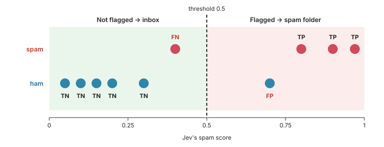
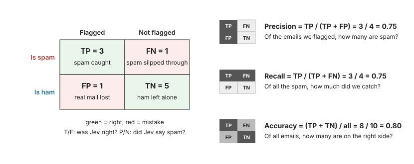
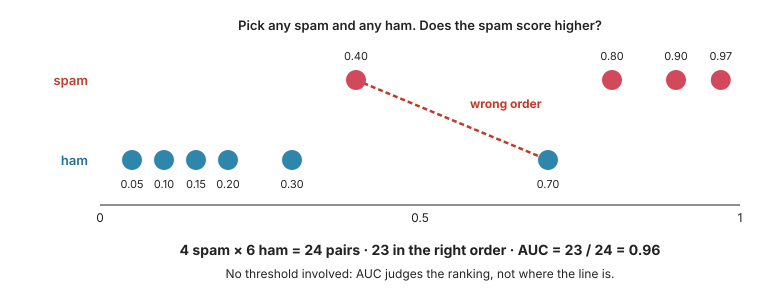

# 5. Measure the baseline (10 min)

[← Ten emails, one request](04-batching.md) · [Agenda](../README.md) · [Next: Split the decision →](06-improve.md)

## Read

`solve.py` classifies a set and prints:

| Metric | Meaning |
|---|---|
| `auc` | Chance that a random spam scores higher than a random ham. 1.0 means the ranking is perfect. |
| `accuracy` | Share of emails labelled correctly at threshold 0.5. |
| `precision` | Share of emails flagged as spam that really are spam. Low precision means real mail lands in the spam folder: **the costly mistake**. |
| `recall` | Share of the spam that got flagged. |

### In pictures

Ten made-up emails, four spam and six ham. Jev gives each one a score, and everything at 0.5 or above gets flagged. That puts every email in one of four boxes:



- **TP** (true positive): spam, flagged.
- **FN** (false negative): spam, not flagged. It lands in the inbox.
- **FP** (false positive): ham, flagged. Real mail lands in the spam folder.
- **TN** (true negative): ham, not flagged.

Count the boxes and you get the confusion matrix. Precision, recall and accuracy each use different cells of it:



AUC ignores the threshold. It only checks whether spam scores higher than ham:



How to read an AUC:

| AUC | Meaning |
|---|---|
| 1.0 | Every spam scores higher than every ham. Some threshold separates them perfectly. |
| 0.9 and up | Excellent ranking: only a few spam–ham pairs are in the wrong order. |
| 0.5 | No better than a coin flip. The scores carry no information about spam. |
| Below 0.5 | Worse than a coin flip, so ham tends to score higher than spam. Something is flipped, such as the question or the labels. |

A high AUC tells you a good threshold *exists*, not that 0.5 is that threshold. That's how a filter can rank almost perfectly and still put real mail in the spam folder. AUC also ignores which mistake costs more, so check precision and recall as well.

## Do

1. Run the solver on the train set:

   ```
   uv run solve.py train
   ```

2. **Write down** the five numbers (`auc`, `accuracy`, `precision`, `recall` and `hard_ham` accuracy) in a notes file or on paper. Step 6 overwrites this run, and you'll compare against these numbers in steps 6 and 7.

3. Create `misses.py` to list the ham that was flagged as spam:

   ```python
   import json
   from pathlib import Path

   from spam.message import summary

   for line in Path("out/train.jsonl").read_text().splitlines():
       row = json.loads(line)
       if not row["is_spam"] and row["spam"] >= 0.5:
           email = summary(Path(row["email"]).read_bytes())
           print(f"{row['spam']:.2f}  {email['from'][:40]:40}  {email['subject'][:60]}")
           print(f"      judgments {row['judgments']}  facts {row['facts']}")
   ```

   `solve.py` keeps a trace of every email in `out/train.jsonl`: Jev's **judgments**, the **facts** code worked out (`facts` in `spam/message.py`), and the resulting `spam` score from `spam/decision.py`. For now the decision just passes Jev's one judgment through, and the facts go unused. Step 6 changes that.

4. Run it:

   ```
   uv run misses.py
   ```

## ✅ Checkpoint

Your numbers should be close to these (Jev's answers vary a little from run to run):

| | auc | accuracy | precision | recall | hard_ham accuracy |
|---|---|---|---|---|---|
| Expected | 0.98 | 0.92–0.94 | 0.83–0.87 | 1.00 | 0.60–0.70 |

Every miss is a **newsletter or shop mail** that the recipient subscribed to: CNET, Ryanair, dELiA*s. The question asks about "commercial email", so Jev calls them spam.

## 🧠 Self-check

Answer each question for yourself before you open it.

<details>
<summary>A set has 40 spam and 60 ham. Jev flags 50 emails as spam: all 40 spam and 10 ham. Fill in the four cells, then work out precision, recall and accuracy.</summary>

| | Flagged as spam | Not flagged |
|---|---|---|
| **Is spam** | 40 (caught) | 0 (slipped through) |
| **Is ham** | 10 (real mail in the spam folder) | 50 (correctly left alone) |

- **Precision** = caught / all flagged = 40 / 50 = **0.80**
- **Recall** = caught / all spam = 40 / 40 = **1.00**
- **Accuracy** = (caught + left alone) / all = (40 + 50) / 100 = **0.90**

Your baseline is close to this: Jev flags 6 to 8 ham instead of 10.

</details>

<details>
<summary>AUC is 0.98 but accuracy only 0.92. How can both be true?</summary>

Take five emails:

| Email | Is | Score |
|---|---|---|
| Pills offer | spam | 0.99 |
| Get-rich-quick | spam | 0.95 |
| CNET newsletter | ham | 0.80 |
| Amazon order mail | ham | 0.70 |
| Mail from a colleague | ham | 0.05 |

- **AUC** asks: does every spam score higher than every ham? Yes, so AUC is 1.0. The order is perfect.
- **Accuracy** asks: is each email on the right side of 0.5? The two newsletters aren't, so accuracy is 3 out of 5.
- With the line at 0.9, all five would be right.

Your baseline has the same problem: almost all spam scores above the hard ham, but 6 to 8 hard-ham emails still score above 0.5.

</details>

<details>
<summary>Why is low precision the costly mistake for a spam filter?</summary>

A missed spam is an annoyance. A real email in the spam folder can go unread.

</details>

<details>
<summary>Why list the misses before changing anything?</summary>

They show what to change. Here they all share one pattern: subscribed newsletters and shop mail. The trace shows the problem too: with one judgment, there's nothing to read except one number.

</details>

[Next: Split the decision →](06-improve.md)
