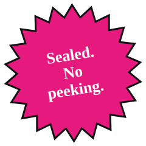

# 05 Test (5 min)

[← 04 Improve](04-improve.md) · [Agenda](../README.md) · [Next: Side quests →](side-quests.md)

**TL;DR.** Open the sealed envelope, once. Inside are 100 emails nobody has looked at.

## Read

### Exam day

A spam filter is only useful on email it hasn't seen yet, like tomorrow's inbox. You can't measure tomorrow's inbox, so you put part of today's email in a sealed envelope and pretend it's tomorrow. That's the **test set**.

Think of an exam. If students practise on the actual exam questions, a perfect score proves they memorised the answers, not that they get the material. The **train set** is the practice questions. Look at it, learn from it, tune on it. The test set is the exam. You take it once, at the end.

> 
> Peek, tweak, re-run, and you didn't build a spam filter. You memorised 100 emails.

### Overfitting

We chose step 04's questions and rule after reading the train misses: CNET, Amazon, Ryanair. They capture a real pattern, but those particular emails shaped them too. Part of your train gain comes from **fitting the emails you looked at**, not spam in general. That's called **overfitting**: a change that looks better on the data you tuned on than it really is in the wild.

The train score can't show you overfitting, because it's measured on the very emails you tuned on. Only emails you never looked at can. Time to open the envelope.

Two rules follow:

- **Tune on train, check on test.** Every time you change something because of a test result, part of the test set leaks into your filter, and the test score gets as optimistic as the train score.
- **Small sets are noisy.** With 100 test emails, one email is worth 0.01 accuracy. `hard_ham` has only 20 emails, so there one email is worth 0.05. Don't read much into a difference of one or two emails.

## Driving with an agent?

Paste this:

```
I'm doing step 05 of the workshop in workshop/05-test.md. Run solve.py on the test set exactly once, then
misses.py on the test set. Show me both outputs next to my train numbers from steps 03 and 04, which are:
<paste your numbers>. Don't change any code after seeing the test results.
```

## Do

1. Open the envelope. Once:

   ```
   uv run solve.py test
   ```

2. Compare the numbers with the ones you wrote down in steps 03 and 04.

3. Read the test misses:

   ```
   uv run misses.py test
   ```

4. Post your test `precision` and `friendly fire` on the leaderboard Jo shares.

## Checkpoint

Your test numbers should be close to the **Test, step 04** row:

| Set            | auc       | accuracy  | precision | recall    | hard_ham accuracy | friendly fire |
| -------------- | --------- | --------- | --------- | --------- | ----------------- | ------------- |
| Train, step 03 | 0.98–0.99 | 0.92–0.94 | 0.83–0.87 | 1.00      | 0.60–0.70         | 6–8           |
| Train, step 04 | 1.00      | 0.95–0.96 | 0.97–1.00 | 0.90–0.93 | 1.00              | 0–1           |
| Test, step 04  | 0.99      | 0.95–0.96 | 0.95      | 0.93–0.95 | 0.90              | 2             |

The expensive mistake dropped on test too. When Jo ran the step 03 filter on the test set, it binned 6 real emails. Yours bins about 2. That gain is bigger than the noise. It's smaller than on train, though, where friendly fire went from 6–8 to 0–1. **That's overfitting in practice.** Accuracy barely moved, because a few more spams now slip through.

The test numbers are what you can honestly expect on new email.

Now look at the `slipped through` lines in the test misses. One or two of those spam ads carry a `List-Unsubscribe` header, `list_mail: True`, so the rule treats their sender as a friend. That's the cheat code from *Spam your neighbour*, used by real spammers in 2002. The train set never showed it. Because the decision is code, you can point at the exact fact that let them in.

🏅 **Badge unlocked: Didn't peek.**

## Leaderboard

Everyone ran the same code, yet the leaderboard isn't one number repeated. Jev's answers wobble from run to run, and on 100 emails one email is a full point. So the winner of the pink feather boa is mostly lucky. That's also a lesson about small test sets.

Jo also crowns the [spam hall of fame](00-boot-up.md#spam-hall-of-fame) winner now.

Last round, one sentence each:

- What surprised you?
- Where would you use Jev in your own work?

## What you take home

- **`state` holds the data, questions point into it.** Name things once and point at them with backticks.
- **Batch to share the cover charge.** 10 emails per request used 37% fewer input tokens, with the small print from step 02.
- **Measure before you change anything**, then read the misses. They tell you what to change.
- **Jev judges, code decides.** Small questions plus facts plus a tested rule beat one big question. When an email goes wrong, the trace shows why.
- **Keep a sealed envelope.** The train score tells you what you tuned for. The test score tells you what to expect.

## Brain on

<details>
<summary>Friendly fire fell from 6–8 to 0–1 on train, but only from 6 to 2 on test. Why the difference?</summary>

The questions and the rule came from reading the train misses, so part of the train gain is fitting those specific emails. That's overfitting.

</details>

<details>
<summary>You spot the faked <code>List-Unsubscribe</code> headers in the test misses, change the rule and run the test set again. What went wrong?</summary>

The test set leaked into your tuning. Its score is now as optimistic as the train score, and you need fresh emails for an honest number.

</details>

### Deep cuts

<details>
<summary>Test accuracy went up by 0.01 or 0.02. Is that proof that splitting the decision helps?</summary>

No. That's one or two emails, within the run-to-run wobble. The drop in friendly fire, from 6 to 2, is the more convincing number, and it's the one that matters for a spam filter.

</details>

<details>
<summary>When Jo ran the step 03 filter on the test set, it scored 0.94 accuracy, higher than its 0.92 on train. Does that matter?</summary>

No. They're different emails, and on 100 emails that's two emails' difference. Small sets are noisy.

</details>

[Next: Side quests →](side-quests.md) · [Back to the agenda](../README.md)
