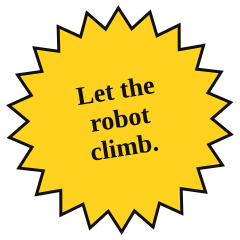

# Side quests (after the workshop)

[← 05 Test](05-test.md) · [Agenda](../README.md)

The workshop's over. The filter isn't. Pick a quest.

## Climb the hill by hand

In step 04 you made one change and measured it. **Hill-climbing** means doing that over and over. Make one small change, measure it on train, keep it if it helps, throw it out if it doesn't.

1. **Measure the wobble first.** Run `uv run solve.py train` twice without changing anything. The difference between the two runs is your noise floor. On 100 emails one email is worth 0.01 accuracy, and identical runs already differ by about that much, so ignore any gain smaller than 0.02 to 0.03.
2. **Change one thing at a time.** Change two things and the score moves, and you won't know which one did it.
3. **Read the misses** with `uv run misses.py` before you pick the next change. Looking is cheaper than guessing.
4. **Keep a log.** Write every experiment, its numbers and your verdict in `hillclimb.md`. The failed experiments matter most, because they stop you from trying the same thing twice.
5. **Open the test set only at the end**, once. Every look makes it less of a test.

### Things to try

Grow the decision. Don't polish the wording. Each idea below adds a judgment, a fact or a path in the rule, and leaves the existing questions alone:

- **Add a judgment** for a pattern in the misses, and a path in `spam/decision.py` that uses it. Jev answers each question on its own, so a new question can't change the answers you've already measured.
- **Add a fact** that code knows exactly. Is the sender a free mail address like hotmail or yahoo? Does the mail have a `Precedence: bulk` header? Remember from step 05 that spammers fake headers.
- **Give "not sure" its own folder.** TypeSafe suggests 0.7 and 0.3 as starting thresholds for a Noul. Above 0.7 is yes, below 0.3 is no, and in between the email doesn't settle the question. The boingboing email with `legit_sender` just under 0.5 belongs there. Decide in code what happens to it, a "maybe spam" folder for example.
- **Fix the cheat code.** Spam with a faked `List-Unsubscribe` header gets in. Find a fact or a judgment that catches it, on train emails or your own red-team emails, not on the test set.

### Watch out for prompt yoga

Some changes push the train score up and make the filter worse on new email:

- criteria that name a specific sender, or that grow a clause for each miss;
- thresholds fitted to a handful of emails;
- rewording a question until one email flips.

The fix is usually a better `state`, a separate question, or code.

### Watch out for overfitting

With 100 emails you'll fit train fast. Step 05 already showed it. Friendly fire fell from 6–8 to 0–1 on train, but only from 6 to 2 on test. To climb on more emails, raise `PER_PARTITION` in `split.py` and run `uv run split.py` again. That redraws **both** sets, so do it before you look at the new test set.

## Let your agent climb

Hill-climbing is a loop with a clear score, which makes it a great job for a coding agent. Ready to play frontier lab scientist? Start your agent in this folder and give it firm rules:

```
Hill-climb the spam filter in this repo on the train set.

Loop:
1. Run `uv run solve.py train` twice to measure the noise floor.
2. Read the misses in out/train.jsonl and pick ONE change: a new judgment in spam/jev.py, a new fact in
   spam/message.py, or a new path in the rule in spam/decision.py.
3. Keep `uv run pytest` green: write or adapt tests for every change.
4. Run `uv run solve.py train`. Keep the change only if it beats the best score by more than the noise floor.
   Otherwise revert it.
5. Log the experiment, its numbers and your verdict in hillclimb.md, then go back to step 2.

Rules:
- Never run `solve.py test` and never read splits/test.txt or out/test.jsonl.
- Jev makes judgments, code makes decisions: don't reword existing questions or add criteria clauses to fix
  individual emails. Read https://typesafe.ai/blog/dont-call-it-a-decision-model and
  .agents/skills/typesafe-ai/SKILL.md first.
- Optimise accuracy, but never let precision drop below its starting value.
- Stop after 20 train runs (200 Jev requests) or 3 experiments in a row without a gain.
- Commit every kept change with git, so I can review the climb step by step.
```

Then check its work:

- **Read `hillclimb.md`.** Do the kept changes make sense, or did the agent fit a handful of train emails? A rule or criterion that names a specific sender is a red flag. So is a criterion that grew a clause for each miss.
- **Run the test set once** with `uv run solve.py test` and compare it with your step 05 numbers.
- **Enforce the rules yourself.** A rule in a prompt is a request, not a guarantee. To be sure the agent can't peek, move `splits/test.txt` out of the folder before you start and put it back when it's done.

## Batching experiments

Every response reports its own token counts in `result.usage.input_tokens` and `result.usage.output_tokens`. Some things to measure:

- **The cover charge.** Send the same emails one per request and then batched, and compare the totals.
- **Batch size against quality.** Run the train set with `GROUP` in `spam/jev.py` at 1, 5, 10 and 20, and plot tokens against accuracy. Where does quality start to drop?
- **Shared criteria.** Move the `scam` criteria from the question into `state`, point at them from each question, and measure the tokens you save.
- **Neighbours.** Shuffle the train set so each email gets different neighbours, run it twice, and compare the answers. How much do the neighbours matter?

## Point Jev at your own problem

Spam was the warm-up. The same moves work anywhere software has to make a call a person could make at a glance: support tickets that need a human, product photos that break the rules, pull requests that touch something risky.

1. Write down the decision your code has to make.
2. Split it into small judgments for Jev and facts for code.
3. Write the rule as a tested function.
4. Label 50 examples, keep a sealed test set, and measure.

Nouls aren't the only kind of question. Jev can also pick a **Choice** among options, place something on a **Score** with levels you describe, or find a **Box** in an image. [.agents/skills/typesafe-ai/SKILL.md](../.agents/skills/typesafe-ai/SKILL.md) and the [TypeSafe docs](https://docs.typesafe.ai/introduction) have the details.

[← Back to the agenda](../README.md)
